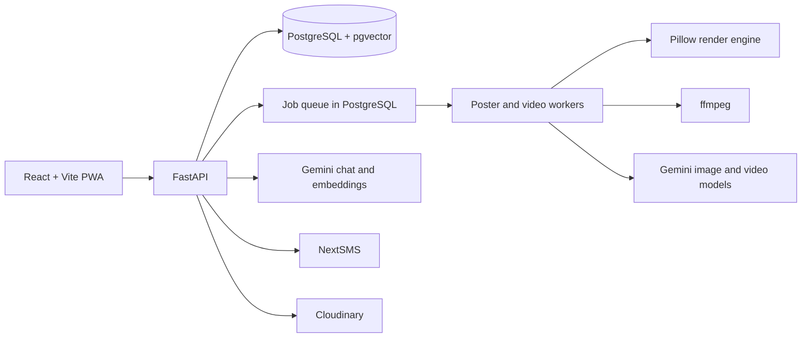

# Wakalabot

**An AI customer-chat platform and a Swahili ad-creator for small businesses in Tanzania.**

> **Status: paused.** Built solo over about four months. It is not currently hosted, so there is no live demo. This README and the source code are the demo. Nothing here claims users or revenue.

Wakalabot is two products on one codebase:

- **Wakalabot (chat):** a multi-tenant SaaS that gives a business or organization an AI assistant for its customers. It answers from the business's own knowledge base, captures leads, and sends SMS alerts.
- **Wakalabot Studio:** a mobile-first tool where a seller uploads a product photo and gets a finished poster, price list, or short promo video in minutes. It uses a prepaid credit system and mobile-money payments.

## Why it exists

Many small sellers in Tanzania sell through social media pages and WhatsApp Status, post raw photos, and answer "bei gani?" (how much?) all day. Studio puts the price, phone number and offer on the picture, in correct Swahili, with no design skills. Payments assume **mobile money (M-Pesa, Tigo Pesa, Airtel Money), not cards**.

## Highlights

- **37 poster designs** (21 single-photo and 16 for two or three photos), **14 price-list designs**, 8 color palettes and 4 sizes (post, portrait, A4 print, Story), all rendered by a Pillow engine.
- **Printed text is never written by AI.** The app typesets every printed word, so Swahili spelling is exact. Text shrinks and wraps to fit and is never cut off.
- **A credit ledger that can't go wrong:** balances can't go negative, every change is recorded, and failed jobs refund idempotently.
- **A job queue inside PostgreSQL** (`SELECT ... FOR UPDATE SKIP LOCKED`), with recovery after a restart.
- **AI cost controls:** daily dollar caps, per-user caps, billing by the seconds actually generated, refunds on failure, and a guard so a crashed job never pays the model twice.
- **Retrieval-augmented chat** on PostgreSQL with pgvector and Gemini, in two bot modes (commerce and information).

## Features

### Wakalabot (chat)
- Multi-tenant accounts, each with its own knowledge base and bot link
- Commerce bots (catalog, prices, orders) and information bots (hours, services, FAQs)
- Lead capture and SMS notifications to the business owner
- Subscription-only billing with daily, weekly, monthly and quarterly plans
- Superadmin panel: tenants, payment approval, revenue and growth charts, AI activity
- Analytics, including a peak-hours heat grid in the local time zone
- An installable PWA with offline-aware error handling
- An optional Instagram integration (needs Meta app credentials)

### Wakalabot Studio
- **Accounts:** phone number plus an SMS one-time code, then a username and password. OTPs are hashed and attempt-limited, and logins lock after repeated failures.
- **Posters:** 1 to 3 photos, a template picker, and a free tier with a small watermark. Clean output costs a few credits.
- **Price lists:** up to 12 items, an optional logo, and 14 designs, free with an optional clean version.
- **AI studio photo:** puts the product on a clean studio background with Gemini image editing. The result is cached for 24 hours, so changing the design costs nothing more.
- **Video:** image-to-video with Gemini Omni, up to 4 scenes of 5, 8 or 10 seconds. Price, phone and captions are drawn by the app and joined with ffmpeg.
- **Sound options:** silent, music, an AI narrator, a presenter who speaks, or the seller's own recorded voice.
- **Free corrections:** card text, design, captions, sound and trim are changed from stored clips, with no new AI call.
- **Payments:** manual mobile-money approval with unique references and an admin screen. It's designed so an automatic provider can replace it.
- **Growth tools:** referral rewards, gift codes, and a pilot program with a budget guard.
- **Safety:** text moderation before any job, signed and expiring media URLs, EXIF stripping, automatic file retention limits, and account suspension after repeated flags.

## Architecture



## Tech stack

| Layer | Tools |
|---|---|
| Backend | Python, FastAPI, async SQLAlchemy, Alembic, slowapi |
| Database | PostgreSQL with pgvector |
| AI | Google Gemini (chat, embeddings, image editing, video) |
| Rendering | Pillow, ffmpeg |
| Frontend | React, Vite, Tailwind CSS, React Query, vite-plugin-pwa |
| Integrations | NextSMS (SMS), Cloudinary (images) |
| Ops | Ubuntu, systemd, GitHub Actions deploys, Alembic migrations |

## Engineering decisions worth reading

- **Posters are rendered by code, not by AI.** AI image models misspell Swahili and sometimes change the product. So AI is used only where it helps (motion, a clean background), and the engine writes all the words.
- **Money-like state is a ledger.** A `CHECK` constraint plus an atomic update means a balance can't go negative under concurrent requests. Refunds are keyed to the job so they can't repeat.
- **I measured a local background-removal model and rejected it.** On the target 1 GB server, the small model I tested needed about 390 MB of extra memory per image. I replaced it with an image-editing API and a cache.
- **A segmentation experiment failed, and I kept the lesson.** Asking a general vision model for outlines produced unusable masks. I switched to an image-editing model that preserves the product, and checked the results by eye on real photos.
- **Cost is a first-class feature.** Credit prices, dollar caps and margins are editable in the admin, and the real model cost is stored on each job.
- **Data-minimizing by design.** Original photos are deleted after processing, outputs expire, and media URLs are signed and short-lived.

## Project structure

```
backend/
  app/
    main.py, core.py, db.py, models.py, schemas.py      # app, settings, database, models
    auth.py, customer_auth.py, limiter.py               # authentication and rate limiting
    knowledge.py                                        # knowledge base and retrieval
    billing.py, subscriptions.py                        # plans and subscription state
    sms.py, notifications.py, analytics.py              # SMS, alerts, analytics
    superadmin.py, sqladmin_setup.py                    # admin
    studio.py                                           # Studio API
    studio_credits.py                                   # credit ledger
    studio_worker.py                                    # job queue worker
    studio_templates.py, studio_multi.py,
    studio_pricelist.py, studio_draw.py                 # rendering engine
    studio_video.py, studio_video_api.py,
    studio_video_cfg.py                                 # video engine and API
    studio_bg.py                                        # AI studio photo (file name is historical)
    studio_gifts.py, studio_admin.py,
    studio_admin_video.py, studio_providers.py,
    studio_config.py, studio_models.py                  # gifts, admin and models
    ...plus supporting modules (products, services, instagram, info_tools, support)
  alembic/                                              # database migrations
frontend/
  src/
    studio/                                             # Studio screens
    features/                                           # admin and feature screens
    pages/, components/, api/, hooks/, store/, data/, utils/
```

## Getting started

**Requirements:** Python 3.12 or newer, Node.js, PostgreSQL with the `pgvector` extension, and `ffmpeg` and `ffprobe` on your PATH.

```bash
# Backend
cd backend
python -m venv env
source env/bin/activate        # Windows: .\env\Scripts\Activate.ps1
pip install -r requirements.txt
cp .env.example .env           # then edit .env (see below)
alembic upgrade head
uvicorn app.main:app --reload

# Frontend (new terminal)
cd frontend
npm install
npm run dev
```

The API runs on `http://localhost:8000` and the app on `http://localhost:5173`. The frontend reads `VITE_API_URL` and defaults to `http://localhost:8000`.

### Configuration

Every setting is defined in `backend/app/core.py` and read from `backend/.env`. Only two are required:

| Setting | Purpose |
|---|---|
| `DATABASE_URL` | Async SQLAlchemy connection string (required) |
| `JWT_SECRET_KEY` | Secret for signing login tokens (required) |
| `SUPERADMIN_SECRET` | Admin panel login. **Set your own value; never keep the default** |
| `GEMINI_API_KEY` | Enables chat, embeddings, image editing and video |
| `NEXTSMS_USERNAME`, `NEXTSMS_PASSWORD`, `NEXTSMS_SENDER_ID` | SMS codes and alerts. `NEXTSMS_DRY_RUN` is a dry-run mode for development |
| `CLOUDINARY_CLOUD_NAME`, `CLOUDINARY_API_KEY`, `CLOUDINARY_API_SECRET` | Image hosting for the chat product |
| `META_APP_ID`, `META_APP_SECRET`, `META_VERIFY_TOKEN` | Optional Instagram integration |
| `ALLOWED_ORIGINS`, `APP_URL` | CORS origins and the public URL |
| `STUDIO_*` | Studio models, caps, retention, payment details, video and AI studio photo options |

`backend/.env.example` lists the most useful settings with safe development values. **Never commit a real `.env` file.**

## Known limitations

- There is **no automated test suite.** Testing was manual, through the UI.
- Single-clip video generation was tested manually. The later multi-scene, caption, own-voice and correction features were built but not tested end to end, and Swahili speech from the video model was not evaluated.
- Payments are **manual approval only.** Automatic mobile-money collection was planned after licensing.
- The AI-poster modes (describe or speak) are disabled in the API.

## What I'd do next

- Add automated tests for the ledger, the queue and the template renderer
- Add pinch-to-zoom and a "fit whole product" mode with a live preview on every design
- Add cheap weekly and monthly passes, and an agent mode for print shops
- Add template categories and a public gallery
- Add automatic mobile-money payments

## License

MIT. See [LICENSE](LICENSE).

## Author

Built by **Manfred Baraka** · manfredbaraka33@gmail.com
